# Layover

**Plan the trip, agree on the money, and keep the group together.**

Layover is an Android-first group travel companion built with Flutter and Supabase. Friends can choose dates and places, agree on a shared budget, record payments and expenses, organize bookings and daily plans, find one another during an outing, and save memories of people they meet.

The app also runs in a browser, with layouts for phones and wider screens. A built-in Goa trip lets you explore most workflows without an account or backend.

**Status:** active development toward an Android pilot. This README describes the repository as of **11 October 2026**. “Implemented” means application/backend code exists; connected use still requires the migrations, provider configuration, and deployment checks below. Proposed features appear separately in the roadmap.

## Contents

- [Why Layover exists](#why-layover-exists)
- [Screenshots](#screenshots)
- [Features available today](#features-available-today)
- [How to use Layover](#how-to-use-layover)
- [Money and booking rules](#money-and-booking-rules)
- [Technology and architecture](#technology-and-architecture)
- [Data flow](#data-flow)
- [Database model](#database-model)
- [Repository layout](#repository-layout)
- [Local setup](#local-setup)
- [Connected setup](#connected-setup)
- [Offline behavior, privacy, and reliability](#offline-behavior-privacy-and-reliability)
- [Testing and verification](#testing-and-verification)
- [Troubleshooting](#troubleshooting)
- [Roadmap and pipeline](#roadmap-and-pipeline)
- [Further documentation](#further-documentation)
- [Contributing and licensing](#contributing-and-licensing)

## Why Layover exists

A group trip often spans a chat, a spreadsheet, booking confirmations, maps, and payment messages. The organizer has to reconcile decisions, commitments, actual costs, and changes across those tools. Travelers need clear answers to “Have we agreed on the stay?”, “Who has paid?”, “Where are we meeting?”, and “What can we do within our budget?”

Layover brings that context into a private trip shared by its members:

| Stage | Group need | Layover features |
| --- | --- | --- |
| Before booking | Agree on dates, choices, and commitments | Polls, shortlists, comments, pot terms, and acceptance history |
| Preparing to leave | Organize plans and responsibilities | Itinerary, bookings, attachments, tasks, reminders, and funded-trip planning |
| During the trip | Coordinate people and spending | Live Map, regroup points, budget exploration, expenses, and payment-message review |
| After the trip | Resolve balances and keep useful records | Settlement suggestions, exports, private memories, archives, and reusable templates |

The first audience is small groups of friends traveling in India. One organizer manages the trip and proposed funding terms. Members vote, accept shares, record expenses, acknowledge money they receive, and choose whether to share locations or memories.

Layover records money moved outside the app. There is no active payment checkout, wallet, custody of funds, or bank-verification integration. Booking details remain traveler-reported records.

## Screenshots

These captures show the compiled Flutter web app using its local demo at **390 × 1000** and **1440 × 1000** viewports. People, costs, places, and locations are demo data. Browser captures illustrate the responsive UI; they do not verify physical-device GPS, camera, or notification capture.

| Trip overview | Plan and decisions | Shared trip pot |
| :---: | :---: | :---: |
| 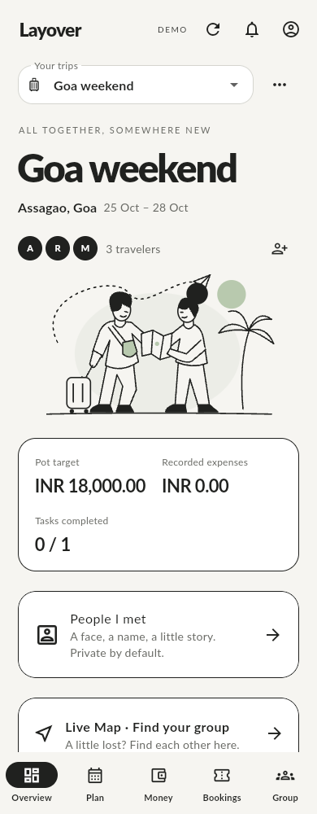 | 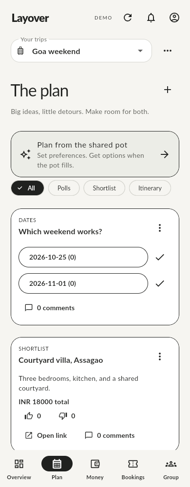 | 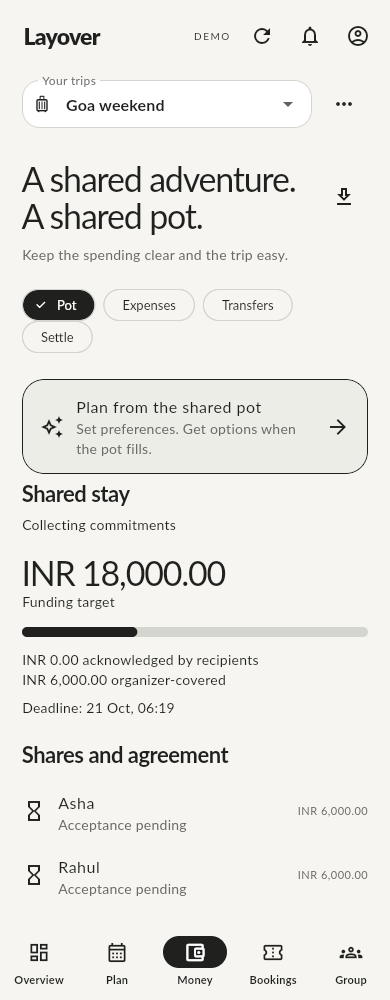 |

| Group coordination | Budget explorer | Live Map session |
| :---: | :---: | :---: |
| 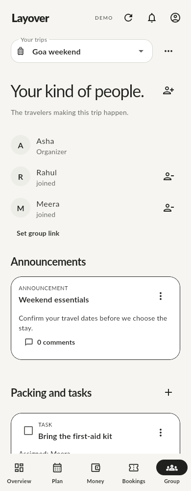 | 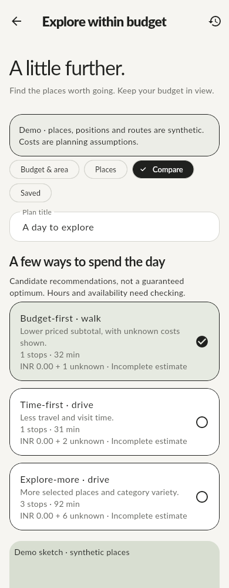 | 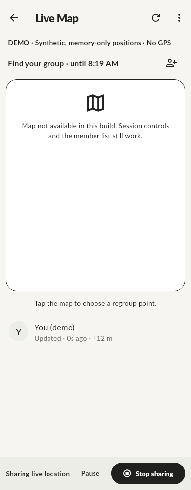 |

The Live Map capture uses synthetic positions and the **missing-Mapbox-token fallback**. A configured build adds the geographic map, markers, recent paths, and optional 3D rendering. The connected funded planner and Android-only camera/notification capture are not illustrated in this browser gallery.

<details>
<summary>Desktop overview</summary>

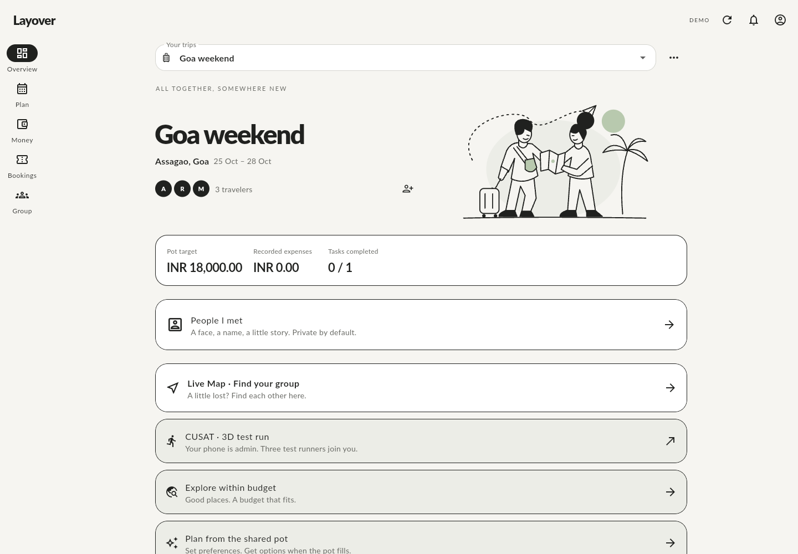

</details>

## Features available today

### Accounts, trips, and navigation

- **Google sign-in:** Supabase browser OAuth with PKCE on Android and web. The sign-in screen offers Google and an isolated demo. Older email-OTP methods remain in the store but are not the current sign-in UI.
- **Trip management:** create/edit a trip, set destination and dates, join by invite code, switch trips, archive/restore, and duplicate reusable content.
- **Membership:** one organizer, joined travelers, expiring/revocable invitations, removal checks, and reinvitation.
- **Responsive navigation:** Overview, Plan, Money, Bookings, and Group use bottom navigation on phones and a navigation rail on wide screens. Other features open from the trip overview.
- **Account tools:** display name, reminder/push preferences, account snapshot export, sign-out, and a deletion request for operational review.
- **Persistent demo:** a Goa trip with Asha, Rahul, and Meera as switchable travelers. Reset restores the sample data.

### Planning and group coordination

- Date/budget polls, votes, comments, and organizer selections.
- Stay/activity shortlists with links, entered prices, notes, and votes; use a shortlisted price as the basis for a pot.
- Dated itinerary entries with times, addresses, notes, and external directions.
- Assigned tasks, packing items, meeting points, and timestamped manual check-ins.
- Announcements, voluntary shared emergency contacts, and a WhatsApp group link.
- Booking records with owner, reference, address, cancellation information, payment due date, and private PDF/image attachments.
- Activity history, in-app notifications, scheduled reminders, and optional Android push.
- Trip templates that copy itinerary/tasks while clearing dates, assignments, completion state, and attachments.

### Trip Pot, expenses, and settlement

- One optional pot per trip: target, deadline, organizer cover, cancellation terms, and individual shares.
- Equal, exact, percentage, and weighted splits using integer paise and deterministic rounding.
- Versioned terms and acceptance history. Revised agreements require fresh acceptance while preserving earlier records.
- Dropout previews and revised shares without silently rewriting historical expenses.
- External transfer reports, recipient acknowledgment/dispute, pending-report withdrawal, corrections, and reimbursements.
- Shared expenses with payer, category, date, receipt, split preview, and auditable void/replacement.
- Personal expenses visible only to their author, excluded from group balances, group activity, notifications, and shared CSV exports.
- Balance calculation, suggested repayments, and CSV expense export.

### Payment-message capture

On Android, **Money → Expenses → Set up capture** enables an opt-in notification listener for one trip and its date window. Supported sources include Google Pay, PhonePe, Paytm, BHIM, Google Messages, and Samsung Messages. Bank alerts must appear as notifications from a selected messaging app; the app does not read the SMS database.

The parser recognizes completed outgoing INR payments and suggests editable expense details. It ignores OTPs, incoming payments, refunds, failures, pending payments, and payment requests. Review a candidate and choose **Split with trip** or **Personal · only me** before submission changes records.

**Paste payment message** provides the same review workflow on other platforms. Offline reviews remain account-bound drafts. Android can queue new notifications while Flutter is closed; opening the app processes the queue. Signing out or changing accounts disables capture and clears its native queue. Notification text does not prove payment settlement.

### Live Map and recent paths

- Create private, time-limited sessions and invite eligible trip contacts.
- Join and give explicit consent before sharing foreground location. Joining alone does not enable sharing.
- See member positions, accuracy/freshness labels, and straight-line distance to a shared regroup point.
- Set a regroup point, follow a traveler, and manage invitations, removal, and session end.
- Use Mapbox on Android/web with 2D maps, optional 3D buildings/terrain, and a fallback for unavailable maps.
- With `live-map-v2` consent, show up to **180 fixes from the last 15 minutes** as a recent path. These are received GPS fixes, not road-snapped navigation.
- Stop/pause sharing on demand. Screen exit or backgrounding stops acquisition and attempts server pause; server leases bound visibility if that request cannot arrive.

Sessions default to two hours and support one to eight hours. Visible sessions poll every three seconds; the server accepts at most one published fix per five seconds. Positions become stale after 15 seconds and disappear after 30 seconds without a fresh accepted fix. Expired publication leases require new consent.

**CUSAT test run:** open **Overview → CUSAT · 3D test run** for three simulated runners, speed controls, paused/offline states, regroup taps, removal, and reset. Simulated coordinates stay in memory and never reach Supabase. The loop and building heights are approximate; this is a UI simulation rather than verified walking directions or a real-GPS test.

### Budget-aware Trip Explorer

Open **Overview → Explore within budget** to:

1. Set group size, dates, available time, budget, category caps, allowances, and contingency.
2. Search a town/landmark, use a foreground location fix, draw a circle/freehand area, undo it, and choose start/finish points.
3. Discover sights, parks, food venues, transport stops, and services through Geoapify, with available source links, cuisine, hours, operator details, and attributed Wikipedia summaries.
4. Review suggested stops; mark places must-visit, optional, or excluded.
5. Compare bounded Budget-first, Time-first, and Explore-more candidates using walking/cycling/driving route metrics where available.
6. Inspect itemized group/per-person costs, ranges, unknown prices, confidence, sources, and checked-at times. Manual costs retain author/time provenance.
7. Save immutable versions and share with current trip members. Organizers see drafts; members see shared versions.

Explorer supports **INR, USD, EUR, GBP, JPY, and KWD** as separate planning currencies. It does not convert currencies or change the INR Trip Pot ledger. Unknown costs remain unknown, rather than becoming zero. Routes may leave the discovery area; opening hours, live fares, availability, and timetable departures require separate checks.

Current bounds include eight stops, up to three distinct recommendations, circles of 100–30,000 metres, and polygons of 3–20 vertices. See [Explorer operations](docs/trip-explorer-operations.md) for geometry, provider limits, and cost semantics.

### Funded trip planner

Organizers open **Plan from the shared pot** from Overview, Plan, or Money. Set room occupancy, departure city, local transport, food preferences, and allowances. Once funding and current-terms acceptance conditions are met, a durable backend job can generate up to three stay-based options.

- SerpApi supplies hotel listings and nearby sights/restaurants/cafes. Open-Meteo supplies applicable forecasts for packing suggestions.
- Options combine a listed total-stay estimate with food, activity, local-transport, and return-travel allowances, leaving 10% of the pot as reserve.
- The organizer reviews and shares an option into itinerary entries, booking checks, tasks, an announcement, and notifications.
- Generated bookings show **To book** until someone enters a confirmation. Estimates and contributions never automatically become actual expenses.
- Regeneration preserves traveler-edited, completed, confirmed, or deleted entries. Job leases and context/run checks prevent stale or duplicate publication.

The worker uses provider data and explicit budget rules; it does not call an LLM. Live generation requires a connected account and configured backend. Current limits include INR, 1–14 trip days, up to 50 travelers, up to 20 rooms, and 1–4 adults per room. Listed rates do not guarantee final price or multi-room availability. See [planner operations](docs/trip-planner-operations.md).

### People I met: private memories

On Android, open **Overview → People I met → Take a photo**. Switch cameras or retake, then add an optional name, note, and place. The app attaches the trip destination and capture time without requesting GPS for memories.

- Save to app-private device storage first, then retry cloud backup while the app is open or resumes.
- Normalize orientation, resize to a maximum 1600-pixel edge, and encode JPEG without EXIF/location metadata.
- Keep memories private by default, including from the organizer. Owners can share online with current trip members and later make them private again.
- Use **Trip actions → My memories** to access owned photos after leaving or archiving a trip.
- Queue offline deletions; server tombstones prevent old clients from restoring deleted memories.

Web supports viewing and managing backed-up memories. Camera capture and durable offline photo saves are Android-only. Keep app data until pending photos finish backup. Private saves and sharing do not create group activity or notifications.

## How to use Layover

1. **Start a trip:** sign in with Google, use the three-dot **Trip actions** menu, set destination/dates, and invite friends.
2. **Make decisions:** add date/budget polls and shortlisted stays or activities; discuss and select options.
3. **Agree on funding:** set the pot, shares, organizer cover, deadline, and terms. Each traveler accepts the current version.
4. **Record contributions:** pay outside Layover, report the transfer, and have its recipient acknowledge receipt.
5. **Prepare:** enter bookings or review funded-planner options. Share the plan, complete reservations outside Layover, and update confirmations.
6. **Travel:** follow the itinerary, check off tasks, explore within a budget, opt into Live Map when useful, and save memories.
7. **Record costs:** add shared/personal expenses or review captured payment messages; check splits and dates before submission.
8. **Finish:** review repayments, make and acknowledge external transfers, export expenses, archive, and reuse content next time.

For a no-account tour, use the local demo and switch travelers in Profile settings. Invitations, cloud attachments, live funded planning, and push require connected services.

## Money and booking rules

| Record | Meaning | Effect |
| --- | --- | --- |
| Pot share | Proposed contribution under a terms version | Tracks commitment and acceptance |
| Organizer cover | Organizer's promised contribution | Counts toward funding readiness; is not a transfer |
| Pending/disputed transfer | Sender's report without recipient confirmation | Does not settle balances |
| Acknowledged transfer | Recipient confirms receiving external money | Updates transfer accounting |
| Shared expense | Actual cost paid for specified travelers | Creates cost allocations |
| Personal expense | Private cost recorded by its author | No group balance effect |
| Explorer/planner estimate | Proposed cost or allowance | No expense, contribution, or reservation |
| Booking record | Group-entered reference or booking task | No independent provider verification |

For example, three friends split a ₹6,000 stay. Two each send ₹2,000 to the organizer, who acknowledges receipt and records paying the ₹6,000 accommodation expense. The contributions are transfers; adding them again as expenses would double-count the funding.

Core financial amounts use integer paise. PostgreSQL computes authoritative shares and validates totals; the client provides previews. Revised terms preserve history but require new acceptance. A member with an unsettled balance or unresolved transfers cannot be removed until those records are resolved.

## Technology and architecture

| Layer | Implementation |
| --- | --- |
| App | Flutter/Dart, Material UI, bundled Lato fonts and travel artwork |
| State and navigation | Riverpod-owned stores, `ChangeNotifier`, Material navigation/routes |
| Identity | Supabase Auth, Google OAuth, PKCE |
| Data and business rules | PostgreSQL, checked RPCs, transactions, row-level security, version checks |
| Files | Private Supabase Storage buckets for attachments and memories |
| Background work | TypeScript/Deno Supabase Edge Functions, scheduled calls, database leases |
| Notifications | In-app records and optional Firebase Cloud Messaging on Android |
| Maps and location | Mapbox Flutter/web integration, GeoJSON layers, Geolocator foreground fixes |
| Discovery and routing | Geoapify through `trip-explorer` |
| Funded planning | SerpApi and Open-Meteo through `trip-planner` |
| Device data | Shared preferences, app-private photos, Android notification queue |
| Verification | Flutter tests, PGlite database suites, provider fixtures, Playwright checks |

The manifest requires **Dart `^3.13.5`**. The documentation build used **Flutter 3.47.7 / Dart 3.13.5**. See [pubspec.yaml](app/pubspec.yaml) for constraints and [pubspec.lock](app/pubspec.lock) for resolved versions. Although `go_router` is declared, the current app shell uses Material navigation.

### System architecture

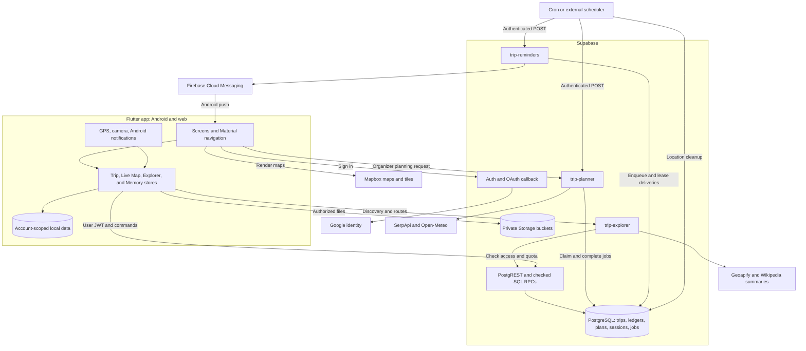

The frontend owns form state, previews, and local drafts. PostgreSQL owns membership, financial validation, immutable terms, command idempotency, and shared records. Edge Functions handle provider calls and scheduled work so provider credentials stay on the server.

The app synchronizes through snapshots and polling: trip data uses a five-second foreground cycle; visible Live Map sessions use a three-second cycle. It does not depend on a Supabase Realtime location stream.

## Data flow

### User input to shared state

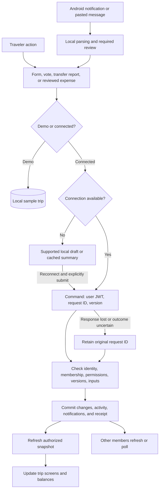

This diagram describes the companion command path. Explorer, Live Map, memories, and planner operations have separate interfaces and lifecycle rules. Location fixes and raw notification text do not enter the shared financial ledger. Offline support is limited to the supported summaries/drafts; arbitrary commands are not queued for automatic replay.

### Funded planner job and publication

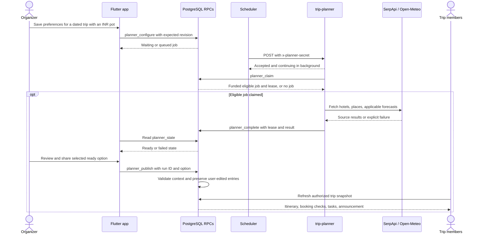

Saving preferences can also invoke the worker as the authenticated organizer. The scheduler allows eligible funded jobs to run with the app closed. An HTTP `accepted` response confirms invocation, not successful itinerary generation.

### Feature-specific paths

| Feature | Path | Persistence and boundary |
| --- | --- | --- |
| Shared trip | Screen → `TripStore` → `companion_command` → database → snapshot | Checked transactions and per-user command receipts |
| Live Map | Consent → fresh foreground GPS → publish RPC → member snapshot → map | Current location and bounded trail; cleanup on stop/expiry; client coordinates in memory |
| Explorer | Area/preferences → provider function → local candidate generation → save/share RPCs | Versioned snapshots; no financial writes |
| Funded planner | Preferences → database job → provider worker → organizer publication | Leased jobs and generated entries; expenses remain separate |
| Memories | Camera → resize/metadata removal → private local file → RPC and Storage upload | Private by default; explicit sharing, account-bound retries, tombstones |
| Payment capture | Android listener → private queue → parser → review → expense command | Only reviewed fields reach Supabase |
| Reminders | Scheduler → enqueue/lease notification → optional FCM | In-app records authoritative; push may be redelivered |

## Database model

This diagram shows selected physical relationships. It omits columns and some history/audit tables for readability. Diagram names use camel case; SQL uses snake case, such as `tripMembers` → `trip_members`.

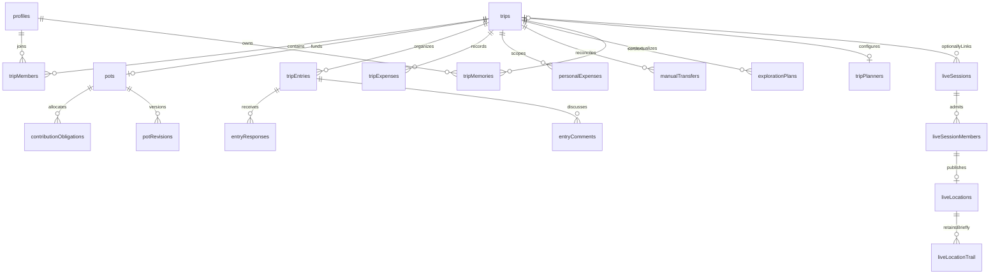

| Domain | Main tables |
| --- | --- |
| Accounts and membership | `profiles`, `trips`, `trip_members`, `invites` |
| Planning/discussion | `trip_entries`, `entry_responses`, `entry_comments` |
| Pot agreements | `pots`, `contribution_obligations`, `pot_revisions`, `term_acceptances` |
| Recorded money | `trip_expenses`, `personal_expenses`, `manual_transfers` |
| Audit/delivery | `trip_activity`, `trip_notifications`, `device_tokens`, `command_receipts` |
| Live Map | `live_sessions`, `live_session_members`, `location_sharing_consents`, `live_locations`, `live_location_trail`, `regroup_destinations`, `live_session_events`, `live_map_receipts` |
| Explorer | `exploration_plans`, `exploration_plan_events`, `exploration_provider_limits` |
| Memories | `trip_memories` and private Storage objects |
| Funded planning | `trip_planners` and generated `trip_entries` |

The initial schema also retains `payment_attempts`, `provider_events`, `refunds`, and `pot_events` from the original provider-payment design. These tables do not establish an active checkout/refund integration. Manual acknowledgments have separate records.

Public interfaces include `companion_snapshot`/`companion_command`, `live_map_sessions`/`live_map_snapshot`/`live_map_command`/`live_map_publish_location`, `explorer_save`/`explorer_share`, `memory_snapshot`/`memory_command`, and `planner_state`/`planner_configure`/`planner_publish`. Restricted worker functions handle claims, completion, reminders, and cleanup. See [migrations](supabase/migrations) for exact signatures, policies, and grants.

## Repository layout

```text
.
├── README.md                         # Product, setup, architecture, roadmap
├── app/
│   ├── lib/
│   │   ├── main.dart                 # Optional Firebase/Supabase initialization
│   │   ├── app/                      # Shell, providers, theme, artwork
│   │   ├── core/                     # Build configuration and shared date fields
│   │   └── features/
│   │       ├── companion/            # Trips, planning, accounting, capture, push
│   │       ├── trip_pot/             # Pot presentation
│   │       ├── live_map/             # Sessions, consent, GPS, trails, map adapter
│   │       ├── trip_explorer/        # Discovery, geometry, budgets, route options
│   │       ├── trip_planner/         # Funded-plan preferences and review
│   │       └── memories/             # Camera, private files, backup, sharing
│   ├── android/                     # Android host and notification listener
│   ├── web/                         # Browser entry point and icons
│   ├── assets/fonts/                # Bundled fonts and license
│   ├── test/                        # Unit, store, and widget tests
│   ├── tool/                        # Preview and browser/client checks
│   ├── env.example.json             # Public configuration template
│   └── pubspec.yaml                 # Dependencies and assets
├── supabase/
│   ├── config.toml                  # Function authentication configuration
│   ├── migrations/                 # Ordered schema and business rules
│   ├── functions/
│   │   ├── trip-explorer/            # Place/routing provider proxy
│   │   ├── trip-planner/             # Funded itinerary worker
│   │   └── trip-reminders/           # Reminders and optional push
│   └── tests/                      # Isolated database/provider/worker checks
├── docs/                           # Setup, operations, verification, screenshots
│   └── archive/                    # Earlier product and hackathon plans
├── PLAN.md                         # Companion release plan and pilot gates
├── prd.md                          # Companion product requirements
├── architecture.md                 # Earlier architecture baseline
├── live-map-implementation-plan.md
└── budget-aware-trip-explorer-plan.md
```

## Local setup

### Prerequisites

| Tool | Purpose |
| --- | --- |
| Flutter with Dart compatible with `^3.13.5` | Fetch dependencies, run, test, build |
| Android SDK, JDK 17-compatible toolchain, emulator/device | Android development; Gradle targets Java 17 |
| Chrome/Chromium | Web development and browser verification |
| Node.js/npm | Preview and check scripts; documentation capture used Node 22 |
| Supabase project and CLI | Connected database and Edge Functions |
| Provider accounts | Optional maps, exploration, funded planning, and push |

Android and web are the configured targets. iOS or desktop-native releases need platform setup and validation.

### Run the no-backend demo

From the repository root:

```sh
cd app
flutter doctor
flutter pub get
flutter devices
flutter run
```

Choose an Android device/emulator, or launch Chrome explicitly:

```sh
flutter run -d chrome --web-port=5183
```

Without valid Supabase build values, the app starts the local Goa demo. Trip changes persist in that device/browser profile. Simulated locations stay in memory; demo memory photos last for the session.

### Serve a compiled browser build

From `app/`:

```sh
flutter build web --release
node tool/preview.cjs
```

Open `http://127.0.0.1:5173`. The server binds to localhost and serves `app/build/web`. Rebuild after code/configuration changes. Use `PORT=5183 node tool/preview.cjs` to change ports.

Most demo workflows need no provider credentials. A Mapbox token enables geographic Live Map/CUSAT rendering. Funded planning needs a connected project and does not substitute invented hotel prices in demo mode.

## Connected setup

### 1. Create a development project and apply migrations

Apply these files **once, in order**, through the Supabase SQL Editor or your established migration workflow:

| Order | Migration | Purpose |
| --- | --- | --- |
| 1 | [`0001_init.sql`](supabase/migrations/0001_init.sql) | Profiles, trips, membership, invites, pots, original provider-payment schema |
| 2 | [`0002_companion.sql`](supabase/migrations/0002_companion.sql) | Content, accounting, RPCs, notifications, idempotency, private `trip-files` bucket |
| 3 | [`0003_live_map.sql`](supabase/migrations/0003_live_map.sql) | Location sessions, consent, RPCs, cleanup |
| 4 | [`0004_trip_explorer.sql`](supabase/migrations/0004_trip_explorer.sql) | Exploration plans, sharing, validation, quotas |
| 5 | [`0005_payment_expenses.sql`](supabase/migrations/0005_payment_expenses.sql) | Expense dates and personal expenses |
| 6 | [`0006_invite_random_bytes.sql`](supabase/migrations/0006_invite_random_bytes.sql) | pgcrypto search-path fix for invite generation |
| 7 | [`0007_live_trails.sql`](supabase/migrations/0007_live_trails.sql) | Recent trails and versioned consent |
| 8 | [`202610110001_trip_memories.sql`](supabase/migrations/202610110001_trip_memories.sql) | Memory metadata, sharing/deletion controls, private photo bucket |
| 9 | [`202610110002_trip_planner.sql`](supabase/migrations/202610110002_trip_planner.sql) | Durable planner jobs and protected publication |

For an existing project, inspect migration history and apply only missing files after checking dependencies. These are migrations, not rerunnable demo seeds. Reconcile SQL-Editor-applied history before adopting CLI migration automation.

Enable Supabase Cron before migration 0003 if you want it to register the cleanup job. If enabled later, use step 5 below.

### 2. Configure Google authentication

Follow [Google sign-in setup](docs/google-sign-in-setup.md), replacing its original development project reference and URLs with your own:

1. Create a Google OAuth **Web application** client for Supabase's browser flow; configure its consent screen and test users.
2. Allow the Google callback `https://<project-ref>.supabase.co/auth/v1/callback`.
3. Enable Google in Supabase Auth and enter the client ID/secret there.
4. Allow `com.layover.layover://login-callback/` and your browser origin/port in Supabase redirects. Include invitation-bearing root URLs as described in the guide.
5. Set the Site URL and verify account selection, cancellation, return callbacks, and sign-out on both platforms.

The Google secret belongs in Supabase. Flutter needs no SMTP settings or Gmail permissions for this flow. Match the allowlist to the port you use: the development commands here use 5183, while the static preview defaults to 5173.

### 3. Set public Flutter configuration

From `app/`, create a local file if one does not already exist:

```sh
cp -n env.example.json env.json
```

Replace the placeholders:

```json
{
  "SUPABASE_URL": "https://YOUR-PROJECT-REF.supabase.co",
  "SUPABASE_PUBLISHABLE_KEY": "YOUR-PUBLISHABLE-KEY",
  "MAPBOX_PUBLIC_TOKEN": "YOUR-MAPBOX-PUBLIC-TOKEN"
}
```

`app/env.json` is gitignored. Build values are compiled into the app, so use **only public client configuration**.

| Build value | Required for |
| --- | --- |
| `SUPABASE_URL` | Connected mode; current detection requires HTTPS |
| `SUPABASE_PUBLISHABLE_KEY` | Connected mode's public client key |
| `MAPBOX_PUBLIC_TOKEN` | Geographic maps; use a public `pk.` token |
| `FIREBASE_APP_ID` | Optional Android push app identifier |
| `FIREBASE_API_KEY` | Optional public Firebase API key |
| `FIREBASE_SENDER_ID` | Optional messaging sender ID |
| `FIREBASE_PROJECT_ID` | Optional Firebase project ID |

Restrict Mapbox tokens for the intended platform. Browser URL restrictions may require a separate native token. Backend service-role keys, provider secrets, and Firebase service-account JSON must stay out of Flutter configuration.

```sh
flutter run --dart-define-from-file=env.json
flutter run -d chrome --web-port=5183 --dart-define-from-file=env.json
flutter build web --release --dart-define-from-file=env.json
flutter build apk --debug --dart-define-from-file=env.json
```

Outputs are `app/build/web/` and `app/build/app/outputs/flutter-apk/app-debug.apk`. The Android Gradle file currently uses debug signing for release builds too. Configure production signing before distribution.

### 4. Configure and deploy Edge Functions

Add secrets through **Supabase → Edge Functions → Secrets** or a private CLI environment file outside the repository.

| Server configuration | Consumer | Purpose |
| --- | --- | --- |
| `GEOAPIFY_API_KEY` | `trip-explorer` | Place search, discovery, routing |
| `SERPAPI_API_KEY` | `trip-planner` | Hotel and local-place results |
| `PLANNER_SECRET` | `trip-planner` | Authenticate scheduled invocations |
| `OPEN_METEO_API_KEY` | `trip-planner` | Optional commercial customer weather endpoint when required for your use |
| `REMINDER_SECRET` | `trip-reminders` | Authenticate scheduled reminders |
| `FIREBASE_SERVICE_ACCOUNT` | `trip-reminders` | Optional FCM service-account JSON |
| `SUPABASE_URL`, `SUPABASE_ANON_KEY`, `SUPABASE_SERVICE_ROLE_KEY` | Function runtime | Supabase-provided environment values; privileged key stays server-side |

With an installed Supabase CLI, run from the repository root:

```sh
supabase login
PROJECT_REF="your-project-ref"
supabase functions deploy trip-explorer --project-ref "$PROJECT_REF"
supabase functions deploy trip-planner --project-ref "$PROJECT_REF"
supabase functions deploy trip-reminders --project-ref "$PROJECT_REF"
```

Optional secret loading from a private file:

```sh
supabase secrets set --env-file /absolute/path/to/layover-server.env --project-ref "$PROJECT_REF"
```

`supabase/config.toml` sets `verify_jwt = false` because these handlers implement their required checks. Explorer validates the user JWT and organizer access; the planner checks organizer access or the scheduler secret; reminders require `x-reminder-secret`. They are not unauthenticated endpoints.

### 5. Configure schedules

| Job | Interval | Operation |
| --- | --- | --- |
| Live location cleanup | Every minute | Database-owner Cron call to `public.live_map_cleanup()` |
| Funded planner | Every minute | POST `/functions/v1/trip-planner`, JSON `{}`, `x-planner-secret` |
| Trip reminders | Every five minutes | POST `/functions/v1/trip-reminders`, `x-reminder-secret` |

Use your project's `https://<project-ref>.supabase.co` base URL. Store scheduler secrets in Vault or the scheduler secret store.

For the planner's dashboard HTTP job, select **POST**, Edge Function **trip-planner**, timeout **5000 ms**, headers `Content-Type: application/json` and `x-planner-secret: <PLANNER_SECRET>`, and body `{}`. The header value must match the function secret. Set an every-minute schedule and save the job.

Scheduled planner calls return `accepted` and continue through `EdgeRuntime.waitUntil`. Inspect job state and function logs for completion/failure. Each invocation processes one eligible job; monitor queue growth. Without Firebase credentials, reminders still create in-app records and report push as unconfigured.

If migration 0003 did not register cleanup, enable Cron, check for an existing job, and create it once as database owner:

```sql
select jobname, schedule, active
from cron.job
where jobname = 'live-map-cleanup';

-- Run only if the job is absent:
select cron.schedule(
  'live-map-cleanup', '* * * * *', 'select public.live_map_cleanup()'
);
```

### 6. Enable device features and verify the journey

- **Push:** add Firebase public values, enable push in Profile settings, grant permission, and verify foreground/background delivery on Android with Google Play services. Browser/iOS push is outside this implementation.
- **Live Map:** provide a Mapbox token and grant foreground permission after session consent. Browser GPS needs a secure context such as HTTPS or localhost. Verify cleanup and two-device behavior.
- **Payment capture:** set trip dates, choose source apps, and grant Android notification access. Re-enable after changing capture dates. Hidden/historical notification text is not available.
- **Memories:** apply the migration, grant camera permission, and check local save, cloud backup, sharing/unsharing, and deletion on Android.

Use two independent development accounts to create/join a trip, accept revised terms, report/acknowledge transfers, add expenses, settle balances, access attachments, and verify revoked membership. A local build does not confirm hosted configuration, provider coverage, or release readiness.

## Offline behavior, privacy, and reliability

| Area | Current behavior |
| --- | --- |
| Trip refresh | After confirmed writes, tab selection/resume, and every five foreground seconds. Coalesced reads; failures back off to at most one attempt per minute. |
| Offline summaries | Account-scoped itinerary/booking summaries exclude financial tables, emergency contacts, and attachment links. |
| Expense drafts | Account-bound local drafts submitted explicitly after reconnection. Financial commands require a connection. |
| Uncertain writes | Keep the original request ID after a lost response. Reuse with changed input is rejected. |
| Concurrent edits | Version/revision checks prevent stale overwrites of entries, pot terms, and planner settings. |
| Membership changes | Next successful refresh removes inaccessible trips/drafts. Sign-out clears trip summaries. Offline cached content cannot be remotely erased without reconnection. |
| Shared attachments | Private `trip-files` bucket, member-authorized reads, uploader-controlled writes, 10 MB PDF/JPEG/PNG limit, 60-second signed download URLs. |
| Memory photos | Separate private bucket; authenticated downloads rather than public/reusable signed photo URLs. Owner-only edits/sharing/deletion. |
| Memory backup | Android private files and retry queue; foreground/resume retries, without guaranteed closed-app uploads. Other members' photos are not stored in the offline library. |
| Memory revocation | Leaving/removal clears sharing; rejoining does not restore it. Revocation cannot retract screenshots or copies already made. |
| Live locations | Client memory only. Server consent generations, sequence/rate checks, leases, access checks, and cleanup bound visibility. Stop/pause/end and location expiry remove associated trails. |
| Payment capture | Private Android queue of up to 200 candidates. Raw text is removed after local processing; only reviewed fields are uploaded. Android backup is disabled. |
| Provider access | Server-only API keys. Explorer caches successful responses for five minutes, bounds requests, and exposes unavailable/unknown states. |
| Push | Generic external notification text; detail stays in the authenticated app. Leased delivery may occur more than once. |

Hosted backup, log, and provider telemetry retention require checks beyond row deletion. See [Live Map operations](docs/live-map-operations.md) for retention and restore requirements. Account deletion currently records a review request; the deployment needs a support owner and a process for shared financial history.

## Testing and verification

### Flutter checks

From `app/`:

```sh
flutter analyze
flutter test --concurrency=1
flutter build web --release
flutter build apk --debug
```

Tests cover accounting/rounding, corrections, sync/recovery, Google OAuth handoff, navigation, payment parsing, location lifecycle/trails, Explorer geometry/budgets/location, memory processing/backup, and planner UI. Android builds and physical checks need the relevant SDK/device.

### Isolated database and provider checks

These suites use PGlite with test auth/storage schemas or fixture-based provider responses. They do not require a hosted database or paid provider calls. Install dependencies outside the repository:

```sh
npm install --prefix /tmp/layover-check @electric-sql/pglite playwright typescript@5.9.3
```

Run from the repository root:

```sh
export NODE_PATH=/tmp/layover-check/node_modules
for test in companion reminders live_map live_trails trip_explorer trip_explorer_provider memories trip_planner trip_planner_worker; do
  node "supabase/tests/$test.cjs" || exit 1
done
```

Two-client simulations exercise synchronization and access over local transports:

```sh
NODE_PATH=/tmp/layover-check/node_modules node app/tool/companion_two_clients.cjs
NODE_PATH=/tmp/layover-check/node_modules node app/tool/live_map_two_clients.cjs
```

Local simulations do not establish hosted HTTP isolation, real GPS behavior, or provider coverage. [Live Map operations](docs/live-map-operations.md) documents a separate `--hosted` check with development user tokens.

### Browser workflows and screenshots

Build the web app and keep `node tool/preview.cjs` running from `app/`. Install a Playwright browser if needed:

```sh
/tmp/layover-check/node_modules/.bin/playwright install chromium
```

In another terminal, from `app/`:

```sh
export NODE_PATH=/tmp/layover-check/node_modules
export PREVIEW_URL=http://127.0.0.1:5173
node tool/browser_check.cjs
node tool/payment_browser_check.cjs
node tool/trip_explorer_browser.cjs
```

For geographic CUSAT rendering, rebuild with a valid Mapbox token and run:

```sh
node tool/campus_browser_check.cjs
```

Set `CHROMIUM_PATH` to use an installed executable. Tools write captures to `/tmp`; selected README captures are in [`docs/screenshots`](docs/screenshots). Set `PREVIEW_URL` to avoid the Explorer check's different default port. Provider assets may require network access and valid tokens.

Historical test counts in operations documents describe individual checkpoints. Run current suites for the current workspace; those older counts do not prove that the latest code has passed every deployment check.

## Troubleshooting

| Symptom | Check or next step |
| --- | --- |
| Demo opens instead of sign-in | Use `--dart-define-from-file=env.json`; confirm an HTTPS Supabase URL and non-placeholder client key, then rebuild. |
| Google returns to the wrong page or fails to return to Android | Check callback, Site URL, redirect allowlist, native scheme, and browser port against the Google setup guide. |
| Add traveler reports `gen_random_bytes(integer) does not exist` | Apply `0006_invite_random_bytes.sql` after prior migrations and retry. |
| Explorer saved plans unavailable or `PGRST205`/`PGRST202` | Verify its migration/RPCs in the selected project. A public client key cannot install them. |
| Place discovery returns 404 or unavailable | Deploy/redeploy `trip-explorer`; verify `GEOAPIFY_API_KEY`, organizer access, and provider quotas. |
| Controls work but map is missing | Check Mapbox token/restrictions, network, WebGL, and content policy. Session controls and lists have a fallback. |
| Explorer GPS fails | Check foreground permission, location services, and browser secure context. Provider setup is a separate dependency. |
| A Live Map marker vanishes | Check freshness, session expiry, consent, and the 30-second lease. Backgrounding stops acquisition. |
| Planner waits for funding | Check acknowledged contributions plus organizer cover and current-terms acceptance, then verify the schedule. |
| Planner reports a missing database update | Apply `202610110002_trip_planner.sql` after dependencies and verify function/secrets. |
| Planner has no affordable option | Review returned stay prices, occupancy, allowances, and reserve. No cheaper hotel quote is invented. |
| Scheduled planner requests succeed but no plan appears | `accepted` confirms invocation. Check durable job state and function logs for completion/failure. |
| Push is absent but in-app records work | Check Firebase values/service account, permission/preferences, `trip-reminders`, and its schedule. |
| Payment notifications are missing | Check Android access, selected source, trip dates, and visible outgoing-payment text. Open the app to process the queue. |
| Memory is local but not backed up | Reconnect/reopen; check backup status and migration/bucket. Preserve app data until backup completes. |
| Browser shows an older UI | Rebuild `app/build/web`; the preview server serves compiled output. |

## Roadmap and pipeline

### Implemented in the current code

Companion workflows, shared-pot accounting, Google sign-in, Live Map, CUSAT simulation, recent paths, payment capture, personal expenses, private memories, drawn-area Explorer, and the funded planner all have implementations in this repository.

Older plans list live location or itinerary generation as future work and describe email OTP. Current code has advanced beyond those baselines: the UI uses Google, live location exists, and the funded planner uses provider data and budget rules. LLM-based drafting remains a separate proposal.

### Next: deployment and pilot readiness

| Workstream | Remaining outcome |
| --- | --- |
| Backend rollout | Confirm deployed migrations/functions, secrets, buckets/policies, and schedules in development. |
| Accounts and groups | Verify fresh Google sign-in, multi-account invitations, revised terms, settlement, membership removal, and private-file access. |
| Devices | Test real Android GPS/lifecycle, camera recovery, notification capture across supported apps, and FCM delivery. |
| Providers | Check target-city coverage, Mapbox restrictions/attribution, route quality, hotel occupancy/prices, forecasts, and quotas. |
| Operations | Configure release signing, monitoring, backup/log retention, deletion review, support ownership, and recovery procedures. |
| Pilot | Observe five groups, fix issues, then expand to twenty. Measure creation/invite acceptance, terms acceptance, settlement, failed requests, crashes, and support reports. |

These are release gates, not evidence of completed production rollout. The older 12–16-week solo-build estimate included integrations and pilot work; it is not a current delivery commitment.

### Proposed later features

| Area | Pipeline idea | Current boundary |
| --- | --- | --- |
| Funding | Multiple pots and co-organizers | One organizer and one optional pot per trip |
| Payments | Provider checkout, automated refunds, installments | External transfers with recipient acknowledgment |
| Expense entry | Receipt OCR | Manual entry and reviewed payment-message parsing |
| Booking intake | Email booking import | Manual records, attachments, generated booking checks |
| Itinerary assistance | LLM-based drafts | Sourced hotel/place data and explicit budgeting rules |
| Transport | Live tracking and richer integrations | Route metrics, allowances, external navigation links |
| Explorer collaboration | Approval workflows and plan archiving | Draft/ready/shared versioned plans |
| Live Map extensions | In-session search/routes; possible delayed sharing or video | Optional ideas subject to P0 acceptance and a separate scope decision |

These ideas come from repository plans; they are not all scheduled or committed. Explorer already has place search/routing. Proposed Live Map extensions would add those capabilities inside live sessions.

## Further documentation

| Document | Purpose |
| --- | --- |
| [App developer notes](app/README.md) | Feature-specific development and device notes |
| [Google setup](docs/google-sign-in-setup.md) | Provider settings, callbacks, platform verification |
| [Live Map operations](docs/live-map-operations.md) | RPCs, consent, trails, cleanup, retention, hosted checks |
| [Explorer operations](docs/trip-explorer-operations.md) | Deployment, geometry, costs, quotas, limits |
| [Explorer integration](docs/trip-explorer-integration.md) | Provider choice and physical schema mapping |
| [Funded planner operations](docs/trip-planner-operations.md) | Worker setup, schedules, estimates, publication |
| [Navigation verification](docs/navigation-verification.md) | Recorded UI/sync checks and deployment limits |
| [Product requirements](prd.md) and [release plan](PLAN.md) | Companion decisions, financial rules, pilot scope |
| [Architecture baseline](architecture.md) | Earlier design; read alongside current code |
| [Live Map plan](live-map-implementation-plan.md) and [logical ERD](live-map-erd.md) | Original scope and acceptance criteria |
| [Explorer plan](budget-aware-trip-explorer-plan.md) and [logical ERD](budget-aware-trip-explorer-erd.md) | Scope and conceptual data model |
| [Archived plans](docs/archive) | Earlier PRD, architecture, hackathon context |

Use current code and feature operations guides to resolve differences with older designs. Some setup guides contain the original development project reference; substitute your own for a separate deployment.

## Contributing and licensing

Read the relevant feature guide, keep changes scoped, and run checks appropriate to the change. Preserve membership checks, private-data boundaries, idempotency, version protection, and the distinction between estimates and actual accounting. Do not commit local configuration, provider credentials, service-account JSON, or screenshots of private account data.

There is no root application license in this repository. Confirm permitted use with the project owner before redistribution. Bundled Lato fonts have their own [license](app/assets/fonts/LICENSE.txt); third-party packages and provider content retain their terms and attribution requirements.
